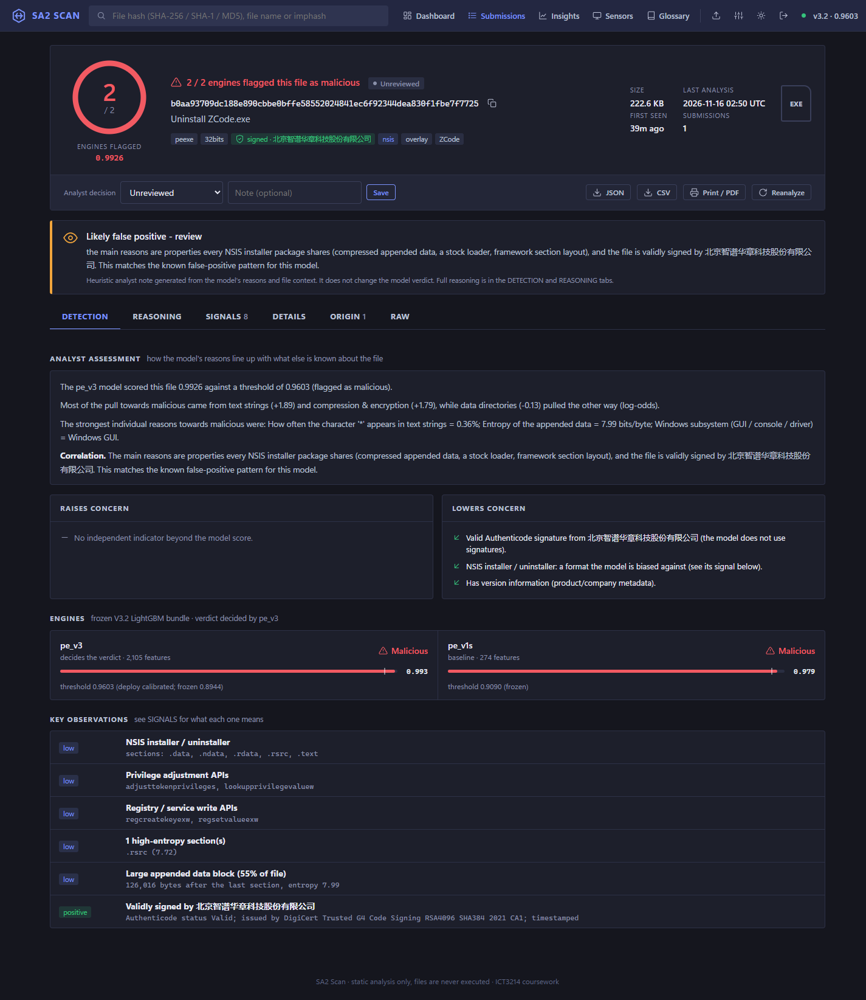

# SA2: Static PE Malware Classification, Scan Dashboard and EDR

ICT3214 Coursework 2. This repository holds three things:

| Part | What it is | Where |
|---|---|---|
| **SA2 Scan** | VirusTotal-style analyst console: upload or search files, read a report that explains *why* each verdict was reached, and track past results and correlations on a dashboard. Scores Windows PE files with the frozen **V3.2** LightGBM models. | `src/webscan/`, port **8000** |
| **SA2 Sentinel** | On-machine EDR agent with a Carbon-Black-style console. Watches processes, network connections and downloads, then sends selected executables to SA2 Scan. | `src/edr/`, port **8001** |
| **Research pipeline** | Static PE + Binary Ninja feature extraction, the three classifiers, and the V1–V9 experiments behind the model. | `src/`, `docs/` |

Everything is **static analysis**: files are hashed and parsed, never executed. The EDR detects only; it never kills or blocks anything.



---

## Quick start (Windows 10/11)

**You need:**
- Windows 10 or 11.
- [Python 3.11, 3.12 or 3.13](https://www.python.org/downloads/), with the `py` launcher (the installer default).
- Git.
- About 500 MB of disk space for the virtual environment.

```powershell
git clone https://github.com/Kinneh04/Sec-Analysis-Coursework-2.git
cd Sec-Analysis-Coursework-2
```

1. **Start the dashboard.** Double-click **`dashboard.setup.bat`**. The first run creates `.venv` and installs `requirements.txt`, which takes 1–3 minutes. The browser then opens http://127.0.0.1:8000. Keep the console window open: it shows the **sign-in password** and the **EDR API key**. Every page requires sign-in; only the `/api/v1/*` endpoints use the API key instead.
2. **Start the EDR.** Double-click **`edr.setup.bat`**. To see every process and connection, right-click it and choose *Run as administrator*. The browser opens http://127.0.0.1:8001/settings.
3. **Connect them.** On the EDR Settings page:
   - Dashboard URL: `http://127.0.0.1:8000`.
   - API key: paste it from the dashboard console, or from **Admin → Sensors & API key**.
   - Press **Test connection**, then **Save**.

   Within 30 s the sensor shows as *Online* in the admin panel.
4. **Try it.**
   - **Upload:** on the home page (http://127.0.0.1:8000) choose any Windows `.exe` or `.dll`, or drop it anywhere. The report shows a detection ring, a plain-English assessment and DETECTION / REASONING / SIGNALS / DETAILS / ORIGIN / RAW tabs, with JSON / CSV / PDF export and an analyst decision (confirmed / false positive / benign).
   - **Dashboard:** http://127.0.0.1:8000/dashboard shows past results and correlations: detections over time, score history, engine agreement (scatter + Pearson r), signal co-occurrence with flag rates, a heatmap of which factor groups drive the highest scores, and the review queue.
   - **EDR transport:** the EDR starts in **Allowlist only** mode. Under Settings → Allowlist, add the full path of a benign `.exe`, then Save. The file is uploaded, scanned, and listed in the EDR's Binary Search and on the dashboard. A worked example is in `dashboard_edr_plan.md` §9.
   - **Normal monitoring:** switch the EDR to **Rules** mode. It then uploads any PE whose rule score is ≥ 2, for example an unsigned file in a user-writable folder.

Both scripts take an optional port (`dashboard.setup.bat 8010`). Without `.bat` files:

```powershell
.\.venv\Scripts\python.exe -m src.webscan.app --port 8000
.\.venv\Scripts\python.exe -m src.edr.app --port 8001
```

### Settings and environment variables

| Variable / flag | Effect |
|---|---|
| `SA2_ADMIN_PASSWORD` | Admin password. If unset, one is generated on first run and printed at every start. |
| `SA2_NO_BROWSER=1` | Setup scripts do not open a browser. |
| `SA2_NO_PAUSE=1` | Setup scripts do not pause on error (for unattended runs). |
| `src.webscan.app --host 0.0.0.0` | Serve the dashboard on the network so an EDR on another machine can connect. Use only on a trusted lab network: this is Flask's development server. |

The EDR console always binds to `127.0.0.1`. Its settings (dashboard URL, key, allow/watch lists, poll interval, watched folders, rules) are edited in its web UI and stored in `artifacts/edr/edr.db`.

### Troubleshooting

| Problem | Fix |
|---|---|
| `Python 3.11, 3.12 or 3.13 was not found` | Install Python from python.org with the `py` launcher, then re-run. |
| `Port 8000 is already in use` | Close the other program, or run `dashboard.setup.bat 8010` and use that URL in the EDR settings. |
| `Missing model: artifacts\v3.2\models\final_pe_v3.pkl` | The clone is incomplete. Run `git pull`; the five files under `artifacts/v3.2/` and `artifacts/deploy/` are tracked. |
| EDR shows **limited visibility** | Run `edr.setup.bat` as administrator. |
| EDR shows **Unauthorized** | The key was rotated or mistyped. Copy it again from Admin → Sensors & API key. |
| Start fresh | Stop both apps and delete `artifacts/dashboard/` and `artifacts/edr/`. A new admin password and API key are generated. |

### Tests

```powershell
.\.venv\Scripts\python.exe -m pytest -q
```

`tests/test_webscan.py` and `tests/test_edr.py` cover upload, scan and report; API-key and admin auth; non-PE rejection; dedup; heartbeat; the EDR rules; the CSRF/host guard; and an end-to-end benign transport from the EDR to a live dashboard. The malicious-verdict UI is tested with a **stub** engine; no malware is used. Four research-pipeline tests need local artifacts that are not in git and **skip** on a fresh clone (expected: 69 passed, 4 skipped).

---

## How the verdict is made

- **Decision model:** `pe_v3` decides the verdict, using 2,105 static PE features (pefile only). The threshold is the **deploy-calibrated 0.9603** (`artifacts/deploy/calibration_temporal_benign.json`, 246 benign files). `pe_v1s` (274 features) is shown as a baseline only.
- **Evidence:** V3.2 met its preregistered blind evaluation, with TPR 0.738 vs 0.597 at 0.63% FPR on 567 files (`docs/v3.2_results.md`). Later EMBER2024 + Binary Ninja blends are **not** deployed, because their gain did not replicate (`docs/v9_results.md`).
- **Explanation (REASONING tab):** a score waterfall by factor group and the top 12 SHAP contributions (LightGBM `pred_contrib`), each translated into plain English and compared with typical benign / malware values from the training pool (`artifacts/v3.2/feature_reference.json`, built by `python -m src.webscan.reference`).
- **Context (SIGNALS tab):** facts the model does not weigh directly: signer, installer/packer format, API capability groups, structural anomalies, EDR origin. Each says what it means and whether it is a known model bias.
- **Assessment:** a heuristic note correlating the reasons with the signals, e.g. "Likely false positive: the main reasons are shared by every NSIS package and the file is validly signed". It never changes the model verdict.
- **Limits:** static features only. Packed or obfuscated payloads may be missed. Treat verdicts as triage, not ground truth.

---

## Research pipeline (needs the private corpus)

The experiments need `E:\MalwareBazaar\extracted` (not distributed), a benign PE corpus, and Binary Ninja. On a Personal license, keep the GUI open and use MCP at `http://127.0.0.1:24642/mcp`. Paths go in `configs/local.yaml` (template: `configs/local.example.yaml`). Generated data goes to `artifacts/` and is not committed, apart from the V3.2 bundle above.

```powershell
.\.venv\Scripts\python.exe -m src.inventory --config configs/local.yaml
.\.venv\Scripts\python.exe -m src.pe_features --config configs/local.yaml
.\.venv\Scripts\python.exe -m src.bn_features --config configs/local.yaml
.\.venv\Scripts\python.exe -m src.build_dataset --config configs/local.yaml
.\.venv\Scripts\python.exe -m src.train --config configs/local.yaml
.\.venv\Scripts\python.exe -m src.evaluate --config configs/local.yaml
# Score files with the frozen V3.2 bundle from the command line:
.\.venv\Scripts\python.exe -m src.v3.score --recursive C:\path\to\folder --summary
```

Results by stage:
- **V1:** PE+BN did not beat PE-only.
- **V2, V3, V3.1:** no confirmed gain.
- **V3.2:** met the preregistered rule.
- **V8 → V9:** the EMBER2024 + BN blend did not replicate.

No SOTA claim is made. See `docs/conclusions.md`, `docs/v3.2_results.md` and `docs/v9_results.md`. Plans: `plan.md` (V1), `SA2_V2_plan.md` (V2+), `fix.md`, `feature_audit_plan.md`, `dashboard_edr_plan.md` (this deployment layer).

`src/dashboard.py` is the earlier Streamlit results page. SA2 Scan supersedes it, and `streamlit` is not in `requirements.txt`.

## Repository layout

```
dashboard.setup.bat, edr.setup.bat   one-click start (scripts/ensure_venv.bat builds .venv)
requirements.txt                     pinned runtime (scikit-learn==1.7.2 matches the frozen pickles)
src/webscan/                         SA2 Scan (Flask): app.py, scanner.py, explain.py (reasons/signals/assessment), reference.py, templates/, static/
src/edr/                             SA2 Sentinel (Flask + agent): app.py, core.py, rules.py, client.py
src/common/                          shared helpers (hashing, sqlite, Authenticode)
src/v3/                              V3.2 feature extractors + scorer used by SA2 Scan
src/ (other), src/v2 … src/v9        research pipeline
artifacts/v3.2/, artifacts/deploy/   the frozen model bundle (only tracked artifacts)
docs/                                methodology, results, preregistrations, ui_refs/, screenshots/
tests/                               pytest suite
```
