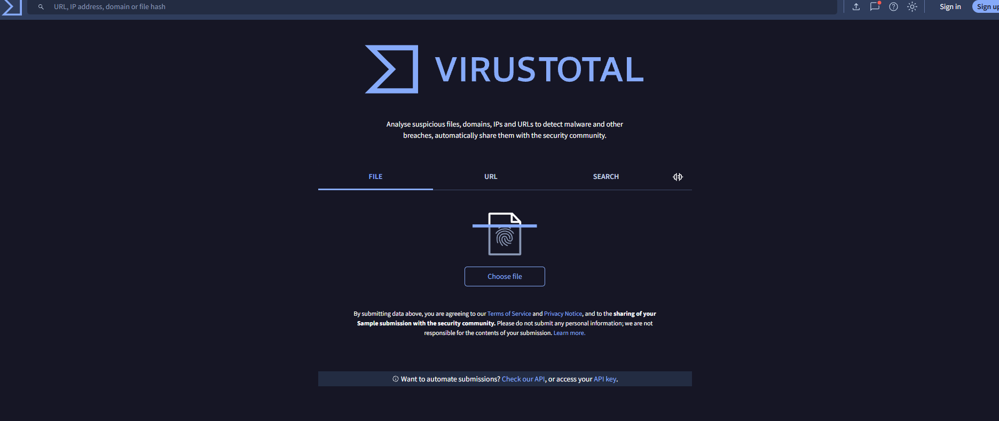
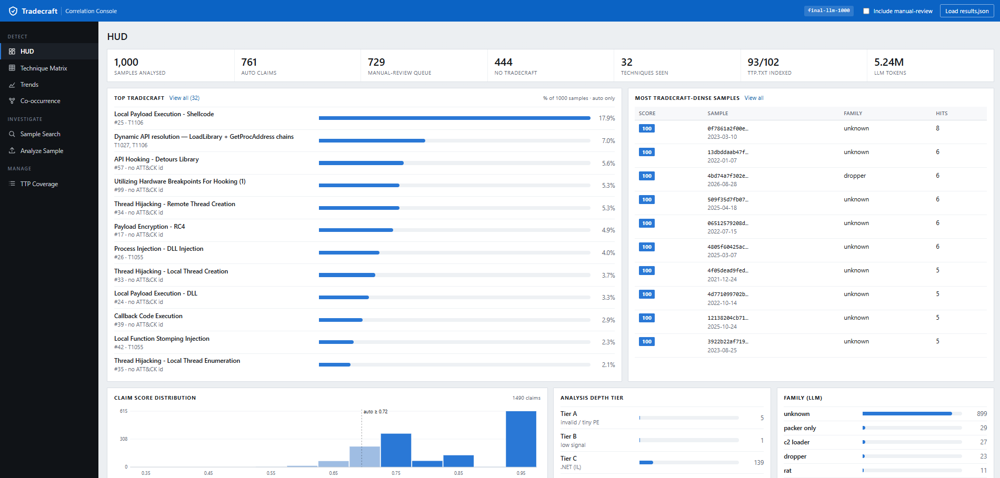
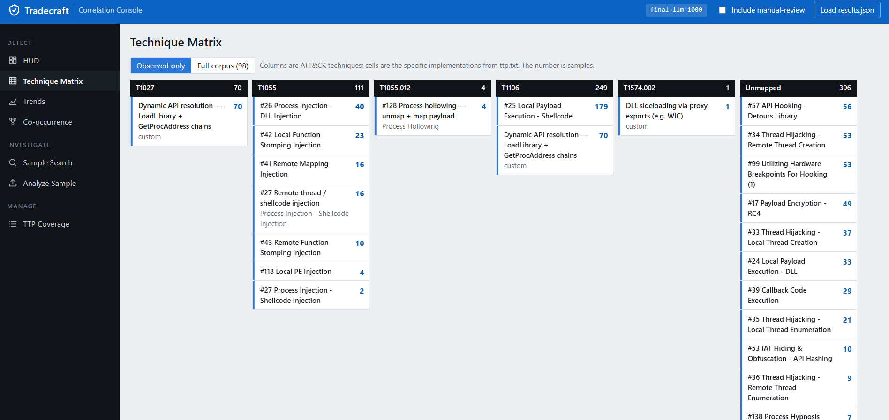
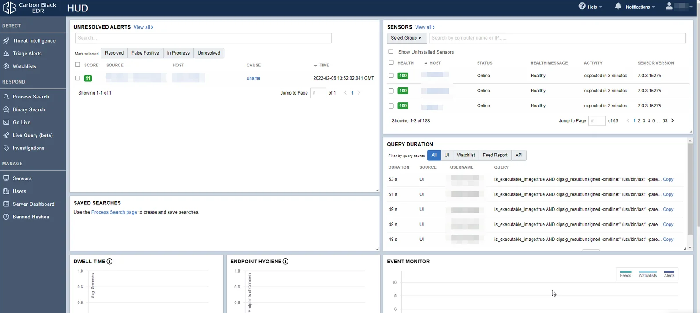

# Dashboard + EDR Plan (SA2 deployment layer)

**Status (2026-11-16):** M0–M5 built and smoke-tested. Both apps start from `dashboard.setup.bat` / `edr.setup.bat`. A benign test app was transported EDR → dashboard via the allowlist and scored benign (§9). 73/73 tests pass. Remaining: written user manual (M6).
**Owner scope:** (1) "SA2 Scan", a file uploader and admin panel modelled on VirusTotal, on port **8000**. (2) "SA2 Sentinel", an EDR agent that runs on this machine, with a web console modelled on Carbon Black, on port **8001**. The agent connects to the SA2 Scan admin panel through settings in its own web UI.
**Upstream:** the ML research in `plan.md`, `SA2_V2_plan.md` and `docs/v3*`–`v9_results.md`. These two apps **consume** the frozen V3.2 models. They do not retrain them or change any research artifact.

## Locked decisions (2026-11-14)

| # | Decision |
|---|---|
| D1 | **Threshold:** deploy-calibrated `pe_v3` threshold **0.9603** (`artifacts/deploy/calibration_temporal_benign.json`). `pe_v1s` keeps its frozen **0.9090**, because no calibrated value exists for it. The report shows the frozen `pe_v3` value (0.8944) as context |
| D2 | **No packet capture.** The EDR is an on-machine agent (process, network-connection and download telemetry). It connects to the admin panel via **web-UI configuration** and tracks **statistics** (§5) |
| D3 | **Engines:** V3.2 only, `pe_v3` (recommended arm, decides the verdict) and `pe_v1s` (baseline). No EMBER, Binary Ninja or V8 |
| D4 | **Demo:** both apps run locally on this machine. **Nothing malicious is run, uploaded or downloaded.** Only benign files are used |
| D5 | Dependencies come from `requirements.txt` and are installed into `.venv` (done) |

---

## 0. Where the project stands

| Stage | State | What it means for us |
|---|---|---|
| V1 (plan.md) | Done | PE+BN did not beat PE-only |
| V2, V3, V3.1 | Done | No confirmed gain |
| **V3.2** | **Blind eval met the preregistered rule** (TPR 0.738 vs 0.597 at 0.63% FPR, `docs/v3.2_results.md`) | **Our engine.** PE-only, pefile + LightGBM |
| V4–V9 | EMBER/BN blends; V8 gain did not replicate in V9 | Not used (D3) |
| Old dashboard | 51-line Streamlit page `src/dashboard.py` | Superseded by SA2 Scan |

The scoring entry point already exists: `src/v3/score.py`:
- `load_bundle("v3.2")` returns the models and thresholds;
- `_feature_row(path)` returns a feature row, or `None` for non-PE / parse failure;
- `score_row(row, bundle)` returns the scores.

**We wrap it. We do not rewrite it.** The only override is the `pe_v3` threshold (D1), applied in our wrapper. The frozen bundle is never edited.

---

## 1. Feasibility

### 1.1 Dashboard: **feasible, verified building blocks**

| Requirement | How | Smoke-tested |
|---|---|---|
| Upload → verdict | Save bytes to quarantine, then `_feature_row` → `score_row`. Static only | ✅ 96–1722 ms per file |
| Engine panel, VT style | 2 engines, shown as "**x / 2** models flag this file" | ✅ both load |
| "Why" section | `model.predict(X, pred_contrib=True)` gives per-feature SHAP from LightGBM itself | ✅ 2,105 features, top contributions returned |
| Non-PE rejection | `_feature_row` returns `None` → HTTP 415 "Not a PE file" | ✅ |
| Detail sections | pefile: hashes, header, sections + entropy, imports, exports, resources, overlay | pefile installed |
| Signature status | `powershell Get-AuthenticodeSignature`, cached per sha256 | ✅ about 200 ms |
| Exports | JSON, CSV (stdlib), PDF via print CSS + browser "Save as PDF" | — |
| URL/IP/domain tabs | **Not offered.** The models are PE-only | — |

### 1.2 EDR agent: **feasible on this machine**

| Capability | How | Smoke-tested |
|---|---|---|
| Process telemetry | `psutil.process_iter` | ✅ 197 processes, exe path visible for 194 (not elevated) |
| Network-connection telemetry, per process | `psutil.net_connections("inet")` | ✅ 148 connections, 147 with PID, 37 remote, all in 10 ms |
| Download origin | Mark-of-the-Web `file:Zone.Identifier` stream (`ZoneId`, `HostUrl`, `ReferrerUrl`) | ✅ read from 198 files in Downloads |
| Unsigned check | Authenticode via PowerShell | ✅ |
| Link to admin panel | HTTP to the dashboard API (§3), configured on the EDR Settings page | design |
| Stats tracking | Counters + per-minute time series in SQLite, plus heartbeats to the dashboard | design |

**Known limits (for the report):**
- Polling every 2 s misses processes that live under 2 s. The upgrade is Sysmon or ETW.
- There is no payload inspection.
- It is detection-only: no process kill or blocking.

### 1.3 Environment: **resolved**

| Item | Result |
|---|---|
| venv | `.venv` on CPython **3.11.15** (`py -V:Astral/CPython3.11.15 -m venv .venv`) |
| Packages | `requirements.txt`: scikit-learn **1.7.2** (pinned to match the pickles), lightgbm **4.7.0**, pandas 3.1.1, numpy 2.4.6, pefile 2024.8.26, Flask 3.1.3, psutil 7.2.2, pytest 9.2.0 |
| **Model reproduction** | 5 benign V3.2 blind-cohort files still on this machine (same sha256) were rescored. `pe_v3` and `pe_v1s` probabilities **match `artifacts/v3.2/blind/blind_scores.parquet` to 6 decimal places** |
| Existing tests | **66 passed** in the new venv |
| Ports | 8000 and 8001 both free |

---

## 2. Tech choices

| Need | Choice |
|---|---|
| Web server, both apps | **Flask** (Jinja2 included) |
| DB | stdlib `sqlite3`, one file per app |
| Frontend | Jinja + vanilla JS + one CSS file per app; **Chart.js** (exact version, cdnjs) for charts |
| Background work | One worker thread + `queue.Queue` per app (`ponytail:` single scan worker; add more if the queue backs up) |
| Dashboard admin auth | One password from env `SA2_ADMIN_PASSWORD`; Flask session cookie |
| EDR → dashboard auth | **API key generated by the dashboard** (`secrets.token_urlsafe`), shown and rotatable on the admin Sensors page, and pasted into the EDR Settings page. Stored in each app's SQLite. No env var needed on the EDR side |
| EDR console auth | Binds to `127.0.0.1` only. Local machine, so no login |
| HTTP client (EDR) | stdlib `urllib.request` with hand-built multipart |

---

## 3. Contract between the apps

| Method | Path | Purpose |
|---|---|---|
| GET | `/api/v1/ping` | **Test connection** button. Returns `{ok, server:"SA2 Scan", model_tag:"v3.2", thresholds}` and checks the key |
| POST | `/api/v1/sensors/heartbeat` | Every 30 s: `{sensor_id, hostname, agent_version, started_at, stats:{…§5.4 counters…}}` |
| GET | `/api/v1/files/<sha256>` | 200 = known (report JSON), 404 = unknown. Used for dedup and verdict polling |
| POST | `/api/v1/files` | multipart `file` + `meta` JSON → `202 {sha256, status:"queued"}`. Web uploads use the same handler without a key |

Every `/api/v1/*` call except the public upload needs header `X-API-Key`; a missing or wrong key gets 401.

`meta` sent by the EDR:

```json
{"source":"edr","sensor_id":"<hostname>","process":"tool.exe","pid":1234,"parent":"explorer.exe",
 "exe_path":"C:\\Users\\x\\Downloads\\tool.exe","remote":["203.0.113.5:443"],
 "motw":{"zone":3,"host_url":"https://…","referrer_url":"…"},"rules":["user_writable","unsigned","motw_internet"]}
```

Report JSON (also the JSON export):

```json
{"sha256":"…","md5":"…","sha1":"…","imphash":"…","size":0,"names":["…"],"first_seen":"…","last_seen":"…",
 "status":"queued|scanning|done|error","verdict":"malicious|benign|error","flag_count":0,"engine_count":2,
 "engines":[{"name":"pe_v3","model_tag":"v3.2","probability":0.006,"threshold":0.9603,"threshold_source":"deploy_calibrated","flagged":false,"recommended":true},
            {"name":"pe_v1s","model_tag":"v3.2","probability":0.02,"threshold":0.9090,"threshold_source":"frozen","flagged":false,"recommended":false}],
 "pe":{"machine":"…","is_dll":false,"timestamp":"…","entry_point":"…","sections":[…],"imports":{…},"exports":[],"overlay_size":0,"signature":"Valid|NotSigned|…"},
 "top_features":[{"feature":"pe3_dir_06_size","contribution":-1.30}],
 "submissions":[{"at":"…","source":"web|edr","sensor_id":"…","meta":{}}],
 "scan_ms":0}
```

`verdict` = `pe_v3` flagged at 0.9603. `pe_v1s` is shown for comparison and does not decide.

---

## 4. App 1: SA2 Scan dashboard (port 8000)

### 4.1 UI references

| Reference | Used for |
|---|---|
|  | **Public home/upload.** Dark navy, centred logo + tagline, FILE / SEARCH tabs, fingerprint-file icon, outlined "Choose file", disclaimer, API banner |
|  | **Admin HUD.** Blue top bar, dark sidebar grouped DETECT / INVESTIGATE / MANAGE, KPI strip, ranked bar list, table with score badges, score histogram with a dashed threshold line |
|  | **Grouped-card view** for top imports / DLLs among submissions |

### 4.2 Pages

**Public**
- `/`: VT-style home. Drag-and-drop / Choose file, 50 MB cap. The SEARCH tab takes sha256, md5, sha1 or a filename.
- `/file/<sha256>`: the report page.
  - Header: circular gauge "**x / 2**" (red if malicious, green if benign); hashes, names, size, first/last seen, PE32/PE32+, EXE/DLL.
  - Buttons: Export JSON · Export CSV · Print/PDF · Reanalyse (admin only).
  - Tabs:
    1. **DETECTION**: per engine, a probability bar with a threshold tick, the threshold and its source, and a verdict pill. Footer gives V3.2 provenance plus the limitation note (static-only, blind cohort size).
    2. **DETAILS**: hashes, PE header, sections table (entropy bar, RWX highlighted), imports by DLL (collapsible), exports, resources, overlay, signature.
    3. **WHY**: top 15 SHAP contributions as a diverging bar chart.
    4. **SOURCE**: each submission (web, or EDR sensor + process, PID, parent, remote endpoints, MOTW URL, rules fired).
    5. **RAW**: the report JSON.
- `/api`: one-page API doc (the "Check our API" banner links here).

**Admin (login)**
- DETECT
  - `/admin`, **HUD**.
    - KPIs: Total files · Flagged · Benign · Queued · Errors · Sensors online · Median scan ms.
    - Panels: live recent submissions; `pe_v3` score histogram with the 0.9603 line; submissions over time by verdict; web vs EDR split; top imported DLLs among flagged files.
  - `/admin/submissions`: filters (verdict, source, sensor, date, score range, text), pagination, bulk-select export.
- INVESTIGATE
  - `/admin/search`: hash / filename / import name.
  - `/admin/matrix`: grouped cards by imported DLL.
- MANAGE
  - `/admin/sensors`, the **EDR link page**:
    - API key (show / copy / rotate).
    - Sensors table: health badge, host, status (online if heartbeat < 90 s old), last heartbeat, agent version.
    - Per-sensor **stats from heartbeats**: processes seen, connections, uploads, flagged, alerts open. Click through for that sensor's time-series charts.
  - `/admin/model`: model tag, both thresholds and their sources, freeze verification result (`src.v3.freeze.verify`), real metrics read from `artifacts/v3.2/blind/blind_results.json`.
  - `/admin/export`: bulk CSV / JSON of the current filter.

### 4.3 Storage (`artifacts/dashboard/`, gitignored)
- `quarantine/<sha256>`: raw bytes, no extension, read-only after write. **Never served back for download.**
- `scan.db`:
  - `files(sha256 PK, md5, sha1, imphash, size, first_seen, last_seen, status, verdict, report_json)`
  - `submissions(id, sha256, at, source, sensor_id, filename, meta_json)`
  - `sensors(sensor_id PK, hostname, agent_version, first_seen, last_heartbeat, stats_json)`
  - `sensor_stats(sensor_id, at, stats_json)`, i.e. the heartbeat history used for charts
  - `settings(key PK, value)`, e.g. `api_key`

### 4.4 Code layout

As built:

```
src/common/sqlite_db.py   # shared: tiny thread-safe sqlite3 wrapper (both apps)
src/common/winsig.py      # shared: Authenticode status via PowerShell (path passed by env var, not command string)
src/webscan/
  app.py        # Flask routes (public, admin, api) + scan worker thread
  scanner.py    # wraps src.v3.score; D1 threshold; SHAP top-k; pefile DETAILS (engines + pe_report merged)
  templates/    # base_public, home, report, search, api, admin_*; _macros (gauge, histogram, bars, SVG lines)
  static/       # scan.css, scan.js. No CDN: charts are HTML/SVG, so it works offline
tests/test_webscan.py
```

Run: `.\.venv\Scripts\python.exe -m src.webscan.app --port 8000`

---

## 5. App 2: SA2 Sentinel EDR agent (port 8001)

### 5.1 UI reference

| Reference | Used for |
|---|---|
|  | Whole console. Dark slate top bar, slate-blue sidebar DETECT / RESPOND / MANAGE, white panels: alerts with status buttons (Resolved / False Positive / In Progress / Unresolved), columns SCORE · SOURCE · HOST · CAUSE · TIME; sensor health badge; Dwell Time and Endpoint Hygiene charts; Event Monitor |

### 5.2 Pages

- DETECT
  - `/`, **HUD**:
    - Unresolved Alerts (score badge = `pe_v3` × 100; cause = rules fired; link to the dashboard report).
    - **Connection card**: dashboard URL, status (Connected / Unauthorized / Unreachable / Not configured), last heartbeat, round-trip ms.
    - Event Monitor (processes, connections and alerts per minute).
    - Dwell-time chart (alert created → resolved).
    - Top talkers.
  - `/alerts`: triage with status buttons, bulk select, "Open report" → `<dashboard>/file/<sha256>`.
  - `/watchlist`: hashes or paths to re-alert on sight (detection only).
- RESPOND
  - `/processes`: Process Search (name, pid, parent, user, path, sha256, signed, first seen, connection count).
  - `/network`: connection log (time, process, local → remote, state).
  - `/binaries`: Binary Search (unique hashes, upload state, verdict).
- MANAGE
  - `/stats`: **stat tracking** (§5.4).
  - `/settings`: **admin-panel connection, configured in the web UI**:
    - Fields: Dashboard URL (default `http://127.0.0.1:8000`), API key (paste from the dashboard Sensors page; masked once saved), Sensor name (default hostname), Auto-submit on/off.
    - Buttons: **Test connection** calls `GET /api/v1/ping` and shows OK + model tag + latency, or the error. **Save** writes to `edr.db` and restarts the submitter. **Disconnect** clears the key.
    - Collector settings: poll interval (default 2 s), watched directories (default Downloads, `%TEMP%`, `%APPDATA%`, `%LOCALAPPDATA%`), rule toggles, max file size (50 MB).

### 5.3 Collector + submitter

```
every <poll> s:
  new processes → exe path → sha256 (cached by path+mtime+size) → facts
  net_connections → upsert per pid; mark raw-IP / non-standard-port
  watched dirs → new files with MZ magic → read Zone.Identifier → facts
  facts → rules.evaluate() → [] means record only; non-empty means candidate
candidate & connected & auto-submit:
  GET /files/<sha> → 404 ? POST (meta) : reuse report
verdict poller: queued hashes → GET until done → create/update alert
heartbeat thread: every 30 s POST /sensors/heartbeat with stats snapshot
offline: candidates queue in edr.db (state "pending") and flush on reconnect
```

Rules (pure functions in `rules.py`):
- `user_writable`: path under the user profile, `%TEMP%` or `ProgramData`.
- `motw_internet`: ZoneId ≥ 3.
- `unsigned`: Authenticode status is not Valid.
- `raw_ip_conn`: connected to a literal IP on a non-standard port.
- `first_seen`: hash new to this agent.
- `watchlist`.

**Default allow-list:** signed files under `C:\Windows\` and `C:\Program Files*\` are never uploaded.

Safety:
- Files are only read, never executed or loaded.
- No killing or blocking.
- The console binds to 127.0.0.1.
- Without elevation, some PIDs and paths are hidden, and the UI shows a "limited visibility" badge (smoke test: 194/197 exe paths visible unelevated).

### 5.4 Stat tracking

Counters are kept since agent start and since install. A per-minute time series lives in `edr.db` table `stats_minute(minute, key, value)`, with a 7-day retention purge.

| Group | Stats |
|---|---|
| Telemetry | processes observed, new unique exes, connections observed, unique remote IPs, files seen in watched dirs, MOTW-tagged files |
| Detection | rule hits per rule, candidates, alerts created, alerts by status |
| Submission | uploads sent, dedup hits (already known to dashboard), upload failures, pending queue length, median and p95 upload→verdict latency |
| Verdicts | malicious vs benign returned by the dashboard |
| Triage | mean / median dwell time (created → resolved), false-positive rate (alerts marked FP ÷ resolved) |
| Health | agent uptime, collector loop duration (median ms), last poll time, connection status, heartbeat success rate |

These feed the `/stats` page (KPI strip + Chart.js line and bar charts + CSV export). A snapshot also goes to the dashboard with each heartbeat (§3), so the admin panel's Sensors page shows them per host.

### 5.5 Storage and layout

`artifacts/edr/edr.db` holds:
- `settings`;
- `processes`, `connections`, `binaries`;
- `alerts(id, sha256, host, cause, score, verdict, status, created, updated, resolved)`;
- `watchlist`, `stats_minute`.

As built:

```
src/edr/
  app.py        # Flask console on 127.0.0.1:8001 (Host check + CSRF token); starts agent threads
  core.py       # Agent: collector (psutil, dir watch, MOTW, signature), submitter, heartbeat, stats
  rules.py      # pure rule functions + allowlist/watchlist parsing
  client.py     # stdlib urllib client: ping, heartbeat, lookup, multipart upload
  templates/  static/
tests/test_edr.py
```

The console has no login because it binds to localhost only. It still rejects non-localhost `Host` headers (DNS rebinding) and POSTs without the session CSRF token. Otherwise any web page could post to `127.0.0.1:8001/settings` and repoint the agent at another server.

Run: `.\.venv\Scripts\python.exe -m src.edr.app --port 8001`. The dashboard link is configured in the UI, not by flag.

---

## 6. Demo (local, benign only, per D4)

1. Start SA2 Scan on :8000 and set `SA2_ADMIN_PASSWORD`. In the admin panel, open Sensors and copy the API key.
2. Start Sentinel on :8001. On Settings, paste the URL + key, press **Test connection** (OK, v3.2), then Save. The sensor appears online in the admin panel.
3. Copy a **benign, unsigned** EXE (e.g. one from `C:\Program Files\Git\usr\bin\`) into `Downloads`. Rules `user_writable` + `unsigned` fire. The file is uploaded, scanned (about 0.1–1.7 s) and comes back **benign**. The alert is auto-resolved as benign and the stats update.
4. Copy the same file again: a dedup hit with no re-upload, and the counter increments.
5. Upload a signed benign EXE through the VT-style page and walk through the report tabs and exports.
6. `Test-NetConnection 1.1.1.1 -Port 8443` shows a process→connection row and the `raw_ip_conn` rule.
7. Show the `/stats` charts and the admin panel's sensor stats.

**Malicious-verdict UI:** no benign file on this machine scores above 0.9603 (all V3.2 blind benign rows were checked), and D4 rules out real samples. So the red-gauge and alert path is shown by a **test with a stub engine** in `test_webscan.py` / `test_edr.py`. Screenshots from that test run must be labelled as test fixtures.

---

## 7. Milestones

| # | Deliverable | Done when |
|---|---|---|
| **M0** ✅ | venv + `requirements.txt`; V3.2 scores reproduce; building blocks work | Done 2026-11-14 (§1.3) |
| **M1** ✅ | `scanner.py`; `python -m src.webscan.scanner notepad.exe` prints report JSON | notepad: pe_v3 0.00632, benign, 0/2 |
| **M2** ✅ | Dashboard public pages + API (ping, heartbeat, files) | Upload → done; .txt gets 415; no key gets 401; JSON/CSV/print export |
| **M3** ✅ | Admin panel (login, HUD, submissions + filters + CSV/JSON export, import matrix, sensors + key rotate, per-sensor stats, model page) | Renders with live data (§9) |
| **M4** ✅ | EDR agent (collector, rules, submitter, heartbeat, stats) | Allowlist transport in pytest and live |
| **M5** ✅ | EDR console (HUD, triage alerts, process/network/binary search, statistics, settings + Test connection) | Live browser run (§9) |
| M6 | Tests ✅ (`tests/test_webscan.py`, `tests/test_edr.py`); setup scripts ✅; `docs/dashboard_edr_manual.md` ⬜ | — |

### Smoke tests run per milestone (benign files only)

| Milestone | Smoke test |
|---|---|
| M1 | Score `C:\Windows\System32\notepad.exe`. Expected `pe_v3` ≈ 0.0063 (seen in M0), benign at 0.9603 |
| M2 | Flask test client: upload notepad → 202 → poll → done/benign; upload a .txt → 415; API without key → 401; same file twice → one `files` row, two `submissions` |
| M3 | Login required on `/admin*`; HUD counts equal `SELECT COUNT(*)`; CSV export row count equals the filtered count |
| M4 | Stub dashboard (`http.server` thread in the test): rules fire on a benign unsigned copy in a temp "Downloads"; one upload, then a dedup on the second copy; heartbeat received with stats |
| M5 | Live: both apps running; Settings → Test connection OK; wrong key → "Unauthorized"; dashboard stopped → "Unreachable" plus pending queue grows, then flushes on restart |
| M6 | `.venv\Scripts\python.exe -m pytest -q` all green (66 existing + new) |

---

## 9. Build and smoke-test log (2026-11-16)

### How to run (out of the box)

| App | Start | Opens |
|---|---|---|
| SA2 Scan | double-click `dashboard.setup.bat` (optional arg: port) | `http://127.0.0.1:8000/`. The console prints the **admin password** and the **EDR API key** |
| SA2 Sentinel | double-click `edr.setup.bat`; *Run as administrator* gives full visibility | `http://127.0.0.1:8001/settings` |

Both scripts run `scripts\ensure_venv.bat`. It creates `.venv` with Python 3.11–3.13 if missing and `pip install -r requirements.txt`. Each script then:
- checks the model artifacts (dashboard only) and that the port is free;
- opens the browser a few seconds after start, unless `SA2_NO_BROWSER=1`;
- pauses on failure, unless `SA2_NO_PAUSE=1`.

`.gitattributes` pins `*.bat` to CRLF.

Connect the agent: dashboard **Admin → Sensors & API key** → copy the key → EDR **Settings** → paste key → **Test connection** → **Save**.

### Smoke test: benign test app via allowlist (no malicious files used)

- **Test app:** `%TEMP%\sa2_smoke\benign_test_app.exe`, a copy of Git for Windows' `usr\bin\echo.exe` (GNU coreutils, unsigned, 35,755 bytes). It was **never executed**.
- **Setup:** both apps were launched through their `.setup.bat`. The EDR was configured in a real browser (Playwright): API key, **Test connection** (Connected, 5 ms, model v3.2), allowlist = the test-app path, mode **Allowlist only**, **Save**.

| Check | Result |
|---|---|
| EDR picked up the allowlisted file | origin `allowlist`, rules fired `unsigned, user_writable`, state `pending` → `queued` → `done` |
| Other binaries the EDR saw | 15 recorded, **0 uploaded** (allowlist mode respected) |
| Transported to dashboard | 1 file, submission `source=edr`, `sensor_id=DESKTOP-A7JV44D`, full context meta |
| Dashboard verdict | **benign**: `pe_v3` 0.00424 (thr 0.9603), `pe_v1s` 0.00587 (thr 0.9090), 0/2 flag; scan 319 ms; signature NotSigned |
| Upload → verdict latency | 2.0 s (median and p95, as shown on the EDR Statistics page) |
| EDR alert | created, auto-resolved (`auto: benign verdict`), score 0 |
| Heartbeat / admin panel | sensor **Online**, stats visible on Admin → Sensors → DESKTOP-A7JV44D; heartbeat success 100% |
| Auth | `/admin` without login → 302; API without key → 401 |

Screenshots: `docs/screenshots/` (`scan_home`, `scan_report_edr`, `scan_report_why`, `scan_admin_hud`, `scan_admin_sensor`, `edr_hud`, `edr_stats`, `edr_settings_test`).

### Bugs found by the smoke test and fixed

1. **Settings form → collector crash:** `max_mb` was saved as `"50.0"` and the collector's `int()` raised on every pass, so nothing was collected. Fixed with float parsing and `:g` formatting. Regression test: the console test saves settings via the form, then runs `collect_once()`.
2. **Test connection lost typed values:** after Test, the form re-rendered the saved settings, so Save would discard the pasted key. The form now keeps what was typed.
3. **Admin HUD 500 with data:** the imported `badge` macro could not see the context variable `thr`. It is now a Jinja global. The admin test now seeds a scanned file, so pages are rendered with rows.
4. Agent errors were invisible when stdout was piped. Now `flush=True`.

### Not done / known limits

- `docs/dashboard_edr_manual.md` (M6) is not written yet. The run steps above cover the basics.
- The malicious-verdict UI is only exercised with a **stub engine** in `tests/test_webscan.py`, per D4.
- Counters are "since install": restarting the agent re-observes already-running processes.
- In **Rules** mode, the unsigned `python.exe` copies in `.venv` score 2 (unsigned + user_writable) and would be uploaded. Add their paths to the watch exclusions or keep allowlist mode for demos.
- Flask's development server is used. That is fine on localhost; do not expose the dashboard with `--host 0.0.0.0` outside a trusted lab network.
